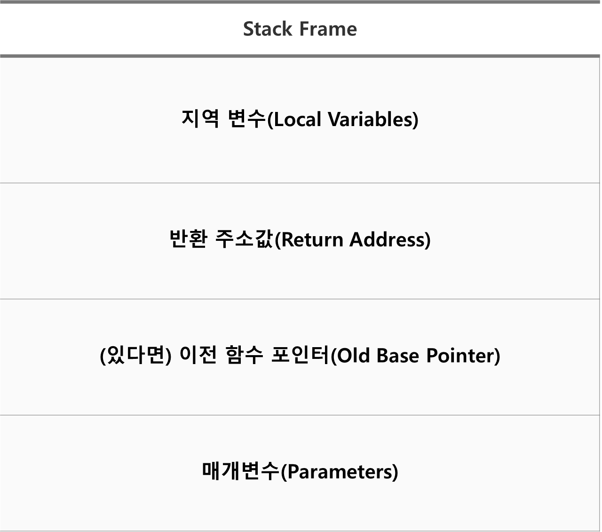

# 스택 프레임(Stack Frame)

## 1. 정의
스택 프레임이란 스택에 저장되는 ***단위***이다.  
해당 프레임의 크기는 '보통' ***1MB***로 한정되어 있다.

## 2. 구성요소
스택 프레임에는 다음과 같은 데이터가 포함된다:
- 지역 변수(Local Variables)
- 반환 주소값(Return Address)
- (있다면) 이전 함수 포인터(Old Base Pointer)
- 매개변수(Parameters)

## 3. 스택 프레임의 생명주기
- 함수가 호출되면 새로운 스택 프레임이 생성된다.
- 함수 실행이 종료되면 해당 스택 프레임은 제거된다.

## 4. 재귀 함수와 스택 프레임
- 재귀 함수는 호출될 때마다 별도의 스택 프레임을 생성한다.
- 따라서 같은 함수라도 호출 횟수만큼 독립적인 스택 프레임이 존재한다.
- 이로 인해 재귀 함수가 가능하지만, 호출이 깊어질수록 스택 메모리를 많이 사용하게 된다.
- 결국 **스택 오버플로우(Stack Overflow)** 에 취약하다.

## 5. 주의사항
- 재귀 함수는 메모리를 많이 소모할 수 있으므로, 단순 반복 구조라면 **for문**으로 대체하는 것이 가능하다.
